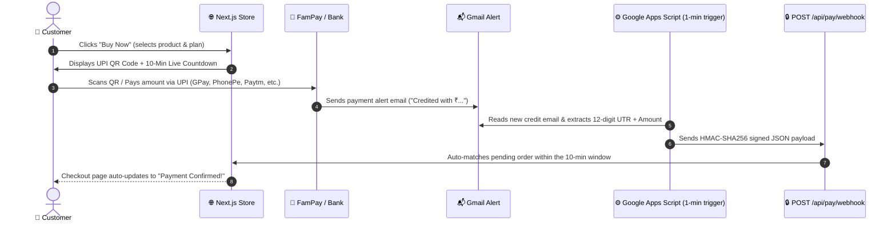

# 💳 FamPay Automatic UPI Payment Verification Setup Guide

This guide explains how your automatic UPI payment system works with FamPay, Google Apps Script, and your Next.js website ("RISHABH JH10C PAY WEB").

---

## 🏗️ Architecture Overview

---

## 🔑 Environment Variables

Make sure the following variables are set in your `.env` (locally) and on **Vercel** (`Project → Settings → Environment Variables`):

| Variable | Description | Example Value |
|---|---|---|
| `FAMPAY_UPI_ID` | Your receiving FamPay UPI ID (server only) | `rishabh04@fam` |
| `UPI_NAME` | Payee name shown inside UPI apps | `RISHABH JH10C PAY` |
| `WEBHOOK_SECRET` | 64-character secret key shared with Google Apps Script | `9f8c4e6b2a1d0f5e7c8b3a4d6f1e2c3b4a5d6e7f8a9b0c1d2e3f4a5b6c7d8e9f` |
| `MONGODB_URI` | Your MongoDB connection string | `mongodb+srv://...` |

> ⚠️ **Security Guarantee**: `FAMPAY_UPI_ID` and `WEBHOOK_SECRET` are never exposed to the client or frontend bundles.

---

## ⚙️ Google Apps Script Setup (5 Minutes)

1. Open [Google Apps Script](https://script.google.com) and sign in with the Google account that receives your FamPay credit alert emails.
2. Click **"+ New project"** and rename it to `FamPay Webhook Forwarder`.
3. Open `Code.gs` and replace all contents with the code from [`scripts/google-apps-script.js`](../scripts/google-apps-script.js).
4. Update the `CONFIG` block at the top:
   - `WEBHOOK_URL`: `https://your-domain.vercel.app/api/pay/webhook`
   - `WEBHOOK_SECRET`: your secret key from `.env`
5. Click **Save** (💾 icon).
6. Click **Run** on the function `testWebhookConnection` to test connectivity with your site. Authorize Gmail and network access when prompted.
7. Click the **Triggers** icon (⏰ clock icon on the left sidebar):
   - Click **+ Add Trigger** (bottom right)
   - Function to run: `processFamPayEmails`
   - Event source: `Time-driven`
   - Type of time based trigger: `Minutes timer`
   - Minute interval: `Every minute`
   - Click **Save**

---

## 🛡️ Double Verification Redundancy

1. **Fully Automated Verification**:
   - The customer pays via QR code.
   - The email arrives, Google Apps Script forwards it to `/api/pay/webhook`.
   - The server matches the amount and time window with the customer's pending order and marks it **Paid** instantly.
   - The checkout page polls every 3 seconds, detects the paid status, and shows the success screen.

2. **Instant Manual UTR Verification (Fallback)**:
   - If the customer wants instant verification before the 1-minute script runs, they can enter their 12-digit UPI UTR in the checkout input and click **"Verify Payment"**.
   - The server atomically verifies that the UTR exists in `payments` (or alerts them to wait 30 seconds if the email is still in transit).
   - Rate-limited to 5 attempts per minute per user to prevent brute-force attacks.

3. **Admin Unclaimed Payments Resolver**:
   - If a customer makes a typo or pays after the 10-minute window, the payment is preserved safely in the `payments` collection as `unclaimed`.
   - The admin panel (`/admin/orders` → **Unclaimed Payments**) displays all unmatched payments with a **"Match with Order"** button to manually link them in 1 click.

